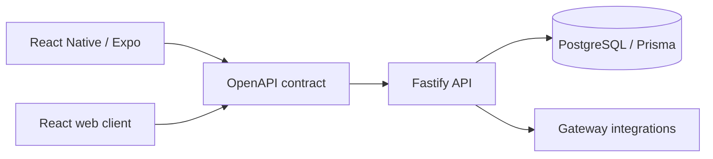

# Camisa7 · Web

[](https://github.com/mkwitko/futebol-web/actions/workflows/ci.yml)

**React · TypeScript · TanStack Query**

Web frontend in the Camisa7 football product family. This is one part of a multi-repository project. Other related components:

- [Camisa7 · React Native](https://github.com/mkwitko/futebol-app)
- [Camisa7 · Backend API](https://github.com/mkwitko/futebol-back)

> **Portfolio status:** Public source available for technical inspection. No live deployment, measured user adoption, current passing CI, or production security posture is asserted by this README. Product/customer data must not be included in demos.

## What the repository contains

React UI and route structure, TanStack Query remote-state integration, generated OpenAPI bindings, tests, type checking and a separate web build.

## System boundaries



This is a conceptual map across repositories based on the inspected stack, not a verified production deployment diagram.

## Inspect the implementation

- [Web routes](src/routes/)
- [Typed API client](src/api/)
- [UI components](src/components/)
- [Test cases](test/)

## Development and checks

Dependencies and configured services are required. Environment values belong in **local files**, never in committed source. Refer to `.env.example` for keys and use demo data only.

```bash
pnpm install --frozen-lockfile
pnpm typecheck
pnpm check
pnpm test:run
pnpm build
```

The commands above are exposed through project scripts; they were **not run** during this documentation update. Verify compatible Node/pnpm versions and services before relying on the setup as a one-command installation.

## Architecture and verification backlog

- [ ] Confirm data ownership and whether third-party marks/screenshots can be shared commercially in a public portfolio.
- [ ] Capture real anonymized web/mobile screenshots, with explicit approval for brands and user content.
- [ ] Explain one cross-repository feature from UI → generated client → route → service → persistence.
- [ ] Add CI based on genuinely passing checks and link the latest runs.
- [ ] Record one reproducible performance measurement (including environment and method) if available.
- [ ] Run secret scanning of the complete Git history and check license/dependency obligations.

**Technical focus:** separation between mobile, web, API contracts and server responsibilities, together with independently testable layers.
