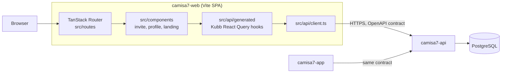
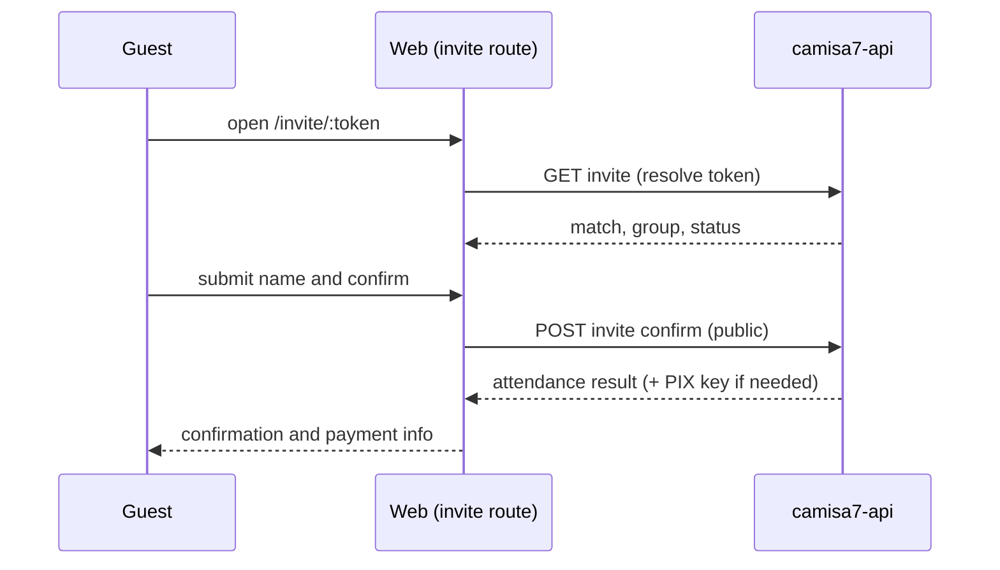

# Camisa7 Web

Small web companion to the Camisa7 app: public invite pages where a guest can confirm presence in a match, and shareable player profile cards.

**Status:** Prototype source, available for portfolio review. Not asserted to be in production; no usage or performance claims are made.

[](https://github.com/mkwitko/camisa7-web/actions/workflows/ci.yml)

## What it does

- Landing page (`src/components/landing`).
- Invite page `/invite/$token`: resolves an invite, shows the match, lets a guest confirm presence without an account, and shows the organizer's PIX key when payment applies (`src/routes/invite`, `src/components/invite`).
- Public player profile `/player/$playerId` with stat tiles and a share button (`src/routes/player`, `src/components/profile`).
- Loading, error and empty states for each page; i18n via i18next (`src/lib/i18n`).

## Architecture



- No auth: the web app only consumes public endpoints (invite resolve/confirm, public profile).
- Server state through React Query; routes are file-based and generated by TanStack Router.
- API hooks and types are generated from `openapi.json` (`kubb.config.ts`) and git-ignored.

### Core flow: guest confirms via invite link



Files: `src/components/invite/invite-page-content.tsx`, `confirm-form.tsx`, `pix-key-section.tsx`.

## Key engineering decisions

- Contract-first generated client instead of hand-written fetchers: `kubb.config.ts`.
- Component tests with MSW handlers typed from the generated types: `test/mocks/handlers.ts`.
- `build` runs the type-check after Vite so type errors fail the build: `package.json`.
- CI regenerates the client, builds, type-checks and tests: `.github/workflows/ci.yml`.

## Tech stack

React, TypeScript, Vite, TanStack Router and Query, Kubb, Tailwind with class-variance-authority, react-hook-form + Zod, i18next, Vitest + Testing Library + MSW, Biome.

## Getting started

Prerequisites: Node >= 22, pnpm 10, a running [camisa7-api](https://github.com/mkwitko/camisa7-api) (or any server matching `openapi.json`).

```bash
pnpm install --frozen-lockfile
cp .env.example .env
pnpm gen:api
pnpm dev
```

| Name | Purpose |
|---|---|
| `VITE_API_URL` | Backend base URL |

## Testing

3 test files, 11 tests (passing locally; CI is green on the default branch). Run `pnpm gen:api` first.

```bash
pnpm check && pnpm typecheck && pnpm test:run && pnpm build
```

## Project structure

```text
src/routes      file-based routes
src/components  invite, profile, landing, ui primitives
src/api         client, query client, generated hooks
src/lib         i18n, formatting, dates
test/           setup, MSW handlers
```

## Related repositories

- [camisa7-api](https://github.com/mkwitko/camisa7-api): Fastify backend
- [camisa7-app](https://github.com/mkwitko/camisa7-app): Expo mobile client

## License

All rights reserved. Source available for portfolio review.
